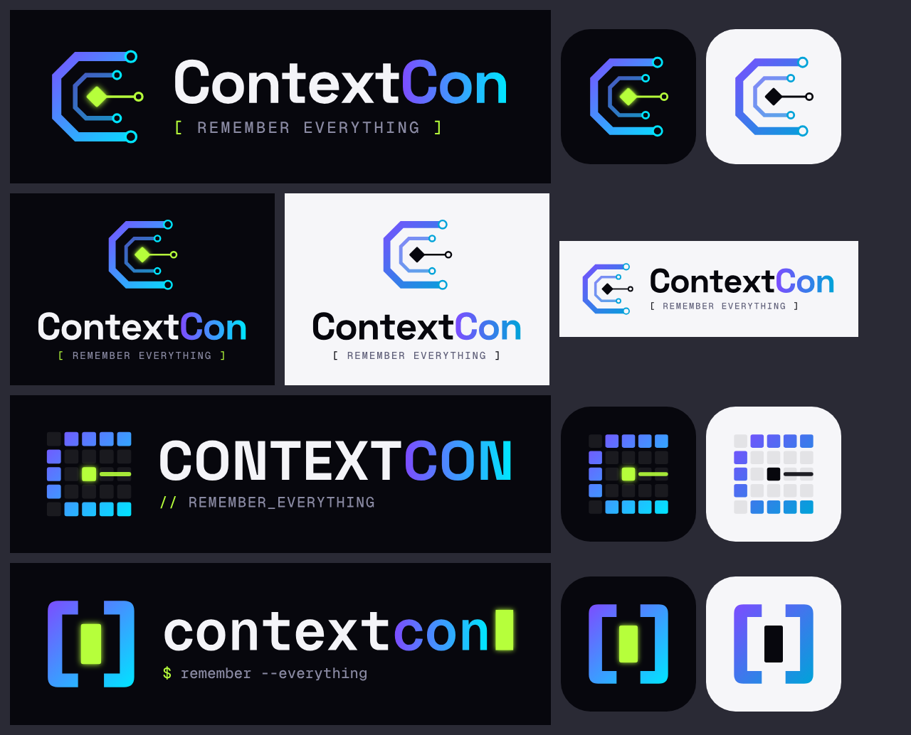

# ContextCon: Remember Everything — Logo concepts (v2, tech direction)

Three developer-native directions. Each folder has horizontal, stacked and icon versions in dark and light (plus transparent), as SVG and PNG.
All lettering is converted to shapes, so the SVGs need no fonts installed.

| Folder | Concept | Mark | Type |
|---|---|---|---|
| `circuit/` **(recommended)** | **Circuit C**: a chamfered "C" traced like a PCB data bus. Memory lanes feed a glowing lime core chip, and an outbound trace carries what was learned to the next agent. | Chamfered C + nodes + core | Space Grotesk Bold · `[ REMEMBER EVERYTHING ]` in Geist Mono |
| `grid/` | **Memory Grid**: a 5×5 matrix of memory cells. The lit cells spell "C" and the lime core cell writes to them. | LED and memory-cell matrix | Space Grotesk Bold caps · `// REMEMBER_EVERYTHING` |
| `term/` | **Context Window**: two brackets hold a live block cursor. It's an agent session that never starts from zero. | `[▮]` | Geist Mono Bold · `$ remember --everything` |

## Palette
| Role | Hex |
|---|---|
| Void (bg / ink) | `#07070D` |
| Paper (light bg) | `#F6F6F9` |
| Electric violet | `#7C4DFF` |
| Cyan (dark) / Cyan (light) | `#00E5FF` / `#00A3D9` |
| Signal lime (core, cursor) | `#B6FF3B` |
| Muted (tagline) | `#8A8AA3` dark · `#5E5E78` light |

The lime core has a soft glow on dark backgrounds. On light backgrounds it turns solid ink.

## Regenerate
`pip install fonttools`, then `python3 generate.py <out-dir> <circuit|grid|term>`. The fonts are in `fonts/` (Geist Mono and Space Grotesk, SIL Open Font License).
